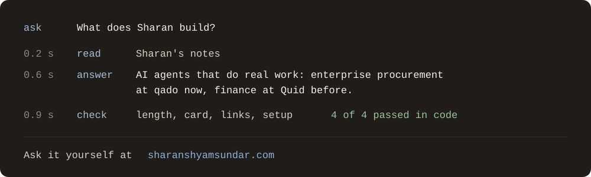
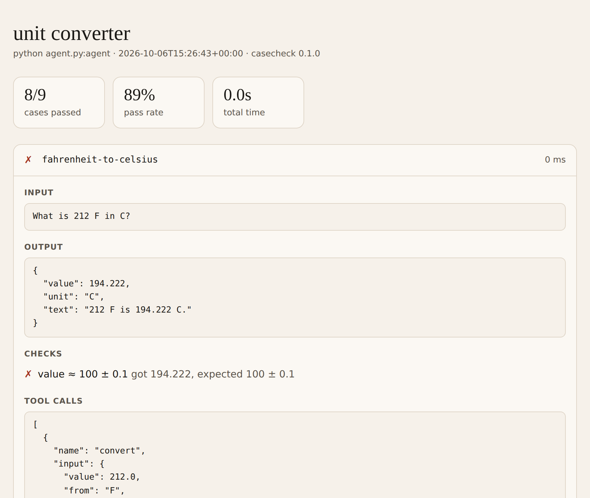
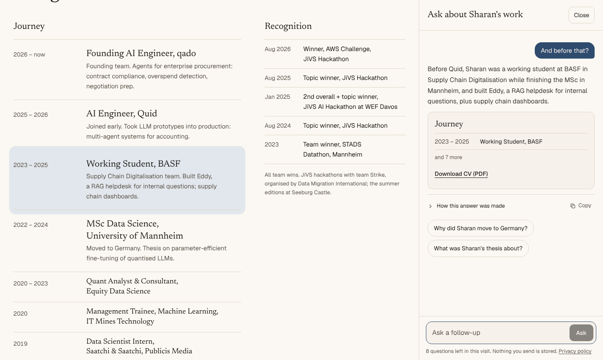

### Hi, I'm Sharan.

Founding AI Engineer at qado in Germany, building agents that help enterprise buyers keep the savings they negotiate. Before that, I built agents that do the books at Quid. I take agents from prototype to production, and I care about the unglamorous part: evals before features, and plain code that checks what the model says before anyone relies on it.

[Website](https://sharanshyamsundar.com) | [LinkedIn](https://www.linkedin.com/in/sharans-1712/) | [Email](mailto:de.sharan17@gmail.com) | [CV (PDF)](https://sharanshyamsundar.com/cv/sharan-shyamsundar-cv.pdf)

#### Things I've built

<table>
<tr>
<td width="50%" valign="top">

 <b><a href="https://github.com/Sharan1712/casecheck">casecheck</a></b> 
Test cases for AI agents. Write cases in YAML, run one command, and see what passed, why the rest failed, and what your last change fixed or broke.
</td>
<td width="50%" valign="top">

 <b><a href="https://sharanshyamsundar.com/en/how-this-site-is-built">The assistant on my website</a></b> 
Answers questions about my work from my own notes, remembers the conversation, and marks the page as it answers. Every change is tested on 53 cases first.
</td>
</tr>
<tr>
<td valign="top">
<b><a href="https://github.com/Sharan1712/quantization_peft">PEFT on quantised LLMs</a></b> 
My MSc thesis: how much quality parameter-efficient fine-tuning keeps on quantised LLaMA models, for the memory it saves.
</td>
<td valign="top">
<b><a href="https://github.com/Sharan1712/Jivs-WEF-Hackathon">ZENIX</a></b> 
Agents that turn plain-language questions into SQL queries and XML business objects. 2nd overall at the JiVS AI Hackathon at WEF Davos, with team Strike.
</td>
</tr>
</table>

Also: a [multi-agent article writer](https://github.com/Sharan1712/crewai-ArticleWriter) and a [project planner](https://github.com/Sharan1712/AllocationPlanningAgent), built with CrewAI.

#### What I work with

Python, TypeScript and SQL. LangGraph, LangChain, Pydantic AI and LangSmith for agents. PostgreSQL, Neo4j and Qdrant for data. Azure, AWS, Docker and Pulumi to ship it.
